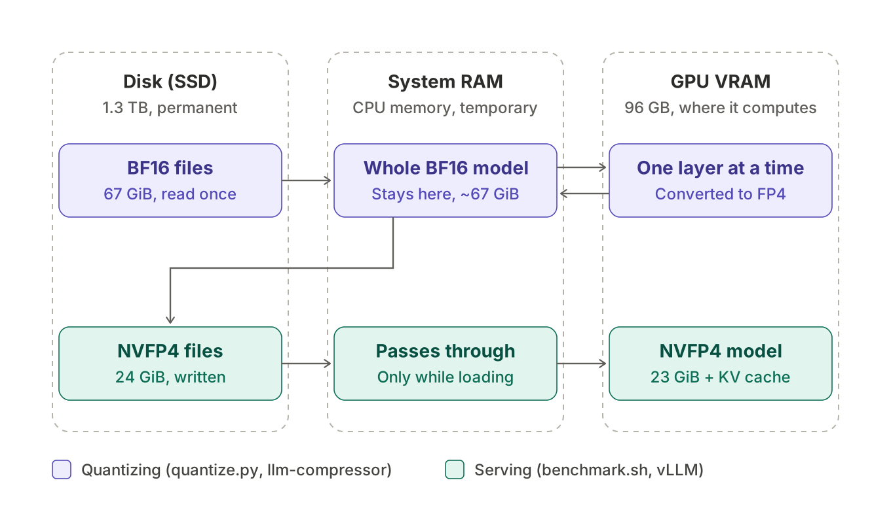

# Qwen3.6-35B-A3B → NVFP4: quantize and benchmark

Scripts to quantize [Qwen/Qwen3.6-35B-A3B](https://huggingface.co/Qwen/Qwen3.6-35B-A3B) to weight-only NVFP4 with [llm-compressor](https://github.com/vllm-project/llm-compressor), and to benchmark any build of the model (quality, speed, size) with identical settings on one GPU.

**Model:** [`peterhdd/Qwen3.6-35B-A3B-NVFP4A16`](https://huggingface.co/peterhdd/Qwen3.6-35B-A3B-NVFP4A16)

## Results

1× NVIDIA RTX PRO 6000 Blackwell (96 GB, sm120), vLLM 0.32.0, every build run through the same `benchmark.sh`.

| Build | Size | MMLU-Pro | Recovery | GSM8K | Recovery | 1-user tok/s | 16-user tok/s |
|---|---|---|---|---|---|---|---|
| Qwen/Qwen3.6-35B-A3B (BF16) | 67 GiB | 0.837 | 100.0% | 0.921 | 100.0% | 147.6 | 793.7 |
| **This build (NVFP4A16)** | 24 GiB | 0.831 | 99.2% | 0.923 | 100.2% | 173.2 | 1,394.8 |
| nvidia/Qwen3.6-35B-A3B-NVFP4 | 22 GiB | 0.831 | 99.2% | 0.926 | 100.6% | 207.5 | 1,507.5 |
| kyaky/Qwen3.6-35B-A3B-NVFP4 | 21 GiB | 0.835 | 99.7% | 0.929 | 100.8% | 188.9 | 1,484.0 |
| RedHatAI/Qwen3.6-35B-A3B-NVFP4 | 24 GiB | 0.829 | 99.1% | 0.927 | 100.7% | 158.8 | 1,330.5 |

Margins of error: about ±0.010 (MMLU-Pro) and ±0.007 (GSM8K). Quality is a tie across all NVFP4 builds and BF16; they differ in size and speed. Raw results, including every question and answer, are in [`results/`](results/).

## Files

| File | What it does |
|---|---|
| `setup.sh` | Installs system packages, uv, two Python environments, and downloads the BF16 model |
| `quantize.py` | Quantizes to NVFP4 (`--scheme w4a16`, default, or `w4a4`) |
| `benchmark.sh` | Serves a model with vLLM and measures size, speed, MMLU-Pro and GSM8K |
| `summarize.py` | Collects everything in `results/` into one comparison table |

## How it works




**Quantizing** (`quantize.py`) keeps the whole BF16 model in system RAM and sends one layer at a time to the GPU for conversion, which is why it needs ~150 GB of RAM but little VRAM. **Serving** (`benchmark.sh`, vLLM) only passes the weights through RAM while loading; the model then lives in GPU memory alongside the KV cache.

## Reproduce

Test machine: Ubuntu with CUDA 13 drivers, 1× RTX PRO 6000 Blackwell (96 GB VRAM), 280 GB RAM, 1.3 TB disk.
Needed:
- **GPU memory (VRAM):** one 96 GB GPU runs both the BF16 model (~67 GiB of weights) and this build (~23 GiB)
- **System RAM:** about 150 GB, to load the BF16 model during quantization
- **Disk:** about 110 GB for the BF16 model plus this build, or about 200 GB to benchmark all five builds

```bash
./setup.sh

# 1. Quantize (quantization environment, ~3 minutes)
source ~/quant-env/bin/activate
python quantize.py
deactivate

# 2. Benchmark (vLLM environment, ~30-60 minutes per model)
source ~/qenv/bin/activate
./benchmark.sh ./Qwen3.6-35B-A3B-NVFP4A16
./benchmark.sh Qwen/Qwen3.6-35B-A3B              # BF16 reference
./benchmark.sh nvidia/Qwen3.6-35B-A3B-NVFP4      # optional: other builds
./benchmark.sh kyaky/Qwen3.6-35B-A3B-NVFP4
./benchmark.sh RedHatAI/Qwen3.6-35B-A3B-NVFP4

# 3. Compare
python summarize.py
```

Run long jobs inside `tmux` so an SSH disconnect doesn't stop them.

### Why two Python environments

llm-compressor from `main` (needed for Qwen3.6 when this was made) requires a pre-release `compressed-tensors`, while vLLM 0.32 pins an older version. Installed together, they break each other. With matching released versions, one environment may be enough.

`setup.sh` collects the steps that worked on the test machine; it has not been run end to end on a fresh VM in one go.

## Benchmark settings

- **Harness:** lm-evaluation-harness against vLLM's chat endpoint, thinking on, 0-shot
- **MMLU-Pro:** `mmlu_pro_llama`, 100 questions per subject (1,400 total)
- **GSM8K:** `gsm8k_cot_llama`, full test set (1,319), flexible-extract
- **Sampling:** temperature 1.0, top_p 0.95, top_k 20, presence_penalty 1.5, max 32,000 new tokens, seed 42
- **Speed:** `vllm bench serve`, random 1,024-in / 512-out prompts, concurrency 1 and 16
- **Server:** `--max-model-len 65536 --max-num-seqs 256 --gpu-memory-utilization 0.90 --language-model-only`

### Pitfalls found along the way

- Plain `mmlu_pro` at 0-shot scored **0.17**: its answer extractor expects a format taught by few-shot examples. `mmlu_pro_llama` states the format in the prompt.
- The BF16 model needs `--max-num-seqs 256`: Qwen3.6's linear-attention layers need one state block per request, and vLLM's default of 1,024 doesn't fit next to 67 GiB of weights.
- Weight-only NVFP4 is data-free in llm-compressor, so calibration settings don't affect the W4A16 build.

## References

- [Qwen/Qwen3.6-35B-A3B](https://huggingface.co/Qwen/Qwen3.6-35B-A3B): base model
- [RedHatAI/Qwen3.6-35B-A3B-NVFP4](https://huggingface.co/RedHatAI/Qwen3.6-35B-A3B-NVFP4): quantization recipe this is adapted from, and sampling settings
- [kyaky/Qwen3.6-35B-A3B-NVFP4](https://huggingface.co/kyaky/Qwen3.6-35B-A3B-NVFP4): weight-only-on-sm120 idea and the comparison format
- [nvidia/Qwen3.6-35B-A3B-NVFP4](https://huggingface.co/nvidia/Qwen3.6-35B-A3B-NVFP4): compared build
- [llm-compressor](https://github.com/vllm-project/llm-compressor), [compressed-tensors](https://github.com/vllm-project/compressed-tensors), [vLLM](https://github.com/vllm-project/vllm), [lm-evaluation-harness](https://github.com/EleutherAI/lm-evaluation-harness)

## License

Scripts: Apache 2.0. The model weights follow the [base model's license](https://huggingface.co/Qwen/Qwen3.6-35B-A3B) (Apache 2.0).